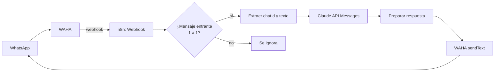

# n8n · Agente de WhatsApp con LLM (WAHA + Claude)

Flujo de [n8n](https://n8n.io) que responde mensajes de WhatsApp con un modelo de lenguaje (Claude). WhatsApp se conecta con [WAHA](https://waha.devlike.pro) y todo corre en infraestructura propia (Docker), sin servicios de pago intermedios más allá de la API del modelo.

> Proyecto de demostración. No contiene datos ni credenciales reales.

## Cómo funciona



1. WAHA recibe el mensaje y lo envía por webhook a n8n.
2. Un filtro descarta mensajes propios, grupos y mensajes sin texto (evita bucles de respuesta).
3. El texto se envía a la API de Claude con un *system prompt* configurable.
4. La respuesta se devuelve al mismo chat con `sendText` de WAHA.

## Requisitos

- n8n (probado con la versión 1.x) y una instancia de WAHA con una sesión de WhatsApp conectada
- Una API key de Anthropic
- Docker (opcional, recomendado)

## Puesta en marcha

1. Define las variables de entorno de n8n usando `.env.example` como guía. Importante: `N8N_BLOCK_ENV_ACCESS_IN_NODE=false`, para que el flujo pueda leer las claves sin guardarlas en el JSON.
2. En n8n: **Workflows → Import from file** y elige `workflows/whatsapp-llm-agent.json`.
3. Publica el flujo y copia la URL de producción del nodo **Webhook WAHA**.
4. En WAHA configura el webhook de la sesión con esa URL y el evento `message`:

```json
{
  "webhooks": [
    { "url": "https://TU-N8N/webhook/waha-llm-agent", "events": ["message"] }
  ]
}
```

5. Escríbele al número conectado. Debe responder en pocos segundos.

## Personalización

- **Personalidad o reglas del asistente:** variable `SYSTEM_PROMPT` (o edita el nodo de Claude).
- **Modelo:** variable `ANTHROPIC_MODEL`.
- **Longitud de respuesta:** `max_tokens` en el nodo de Claude.

## Buenas prácticas incluidas

- Las credenciales viven en variables de entorno, no en el flujo.
- Filtro anti-bucle (`fromMe`) y exclusión de grupos.
- Reintento automático en la llamada al modelo.

## Ideas para extenderlo

- Memoria de conversación por chat (PostgreSQL o la tabla de datos de n8n).
- Consulta a documentos propios (RAG con una base vectorial).
- Escalar a una persona cuando el modelo no sepa responder.
- Herramientas (consultar un pedido, agendar una cita) con nodos de agente y MCP.

## Aviso

Usar WhatsApp con herramientas no oficiales puede ir contra sus términos de uso. Evalúa el riesgo antes de usarlo con números de producción, o considera la API oficial de WhatsApp Business.

## Licencia

MIT
